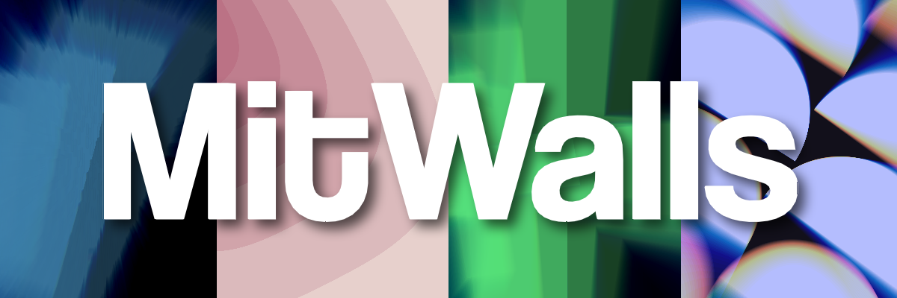
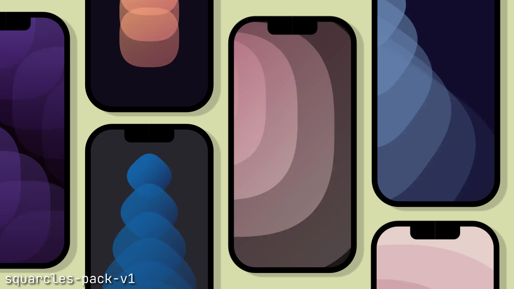

<kbd>
  
</kbd>

<h3 align="center"> Original 4K Wallpapers for Every Mood. Made in Mobile for Mobile</h3>

---

## Squarcles Pack v1
Wallpapers only Made with Shape 'Squarcle'. Contains 11 Wallpapers of 16:9 Ratio

  
  

---
## Download
- You can Download either Whole Packs or Individuals by Clicking The Links.
- OR Go to Release Page and Select Your Favorite Pack and Download from Assets

---
## Support The Project
- You can support this project by Subscribing to my [YouTube channel](https://www.youtube.com/@mitxd)
- OR Give Star to the Project ✨

---
## About This Project
> Every Wallpaper is Made by A Human, No Generative AI was Used in Making of Any Wallpapers or Even any Assets in Repository.

BTW You can Use These Wallpaers in Desktop by Obviously Rotating them 😅

---
<h3 align="center">Made with ❤️ from A Guy who wants to Learn Everything</h3>