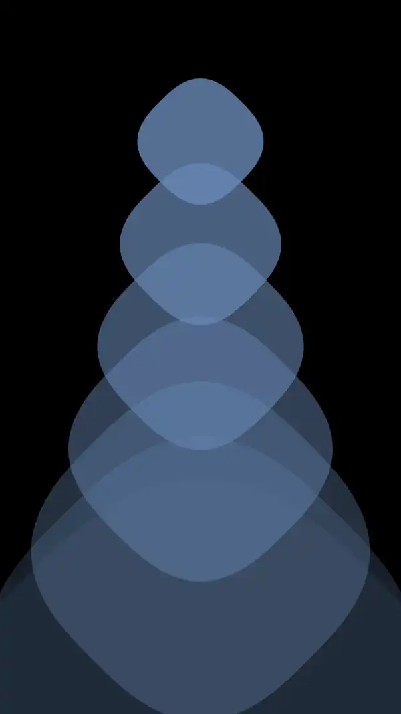

<h2 align="center">Squarcles Pack v1</h2>

      

---

<table align="center" width="100%">
  <tr> 
    <td>
    
      
    <a href="https://github.com/mitxdd/mitwalls/releases/download/squarcles-pack-v1/squarcle-1.png">
      <b>Download</b>
    </a>
    </td>  
    <td>
    
      
    <a href="https://github.com/mitxdd/mitwalls/releases/download/squarcles-pack-v1/squarcle-2.png">
      <b>Download</b>
    </a>
    </td>
  <td>
    
      
    <a href="https://github.com/mitxdd/mitwalls/releases/download/squarcles-pack-v1/squarcle-3.png">
      <b>Download</b>
    </a>
  </td>
 </tr>
 <tr>
  <td>
    
      
    <a href="https://github.com/mitxdd/mitwalls/releases/download/squarcles-pack-v1/squarcle-4.png">
      <b>Download</b>
    </a>
  </td>
  <td>
    
      
    <a href="https://github.com/mitxdd/mitwalls/releases/download/squarcles-pack-v1/squarcle-5.png">
      <b>Download</b>
    </a>
  </td>
  <td>
    
      
    <a href="https://github.com/mitxdd/mitwalls/releases/download/squarcles-pack-v1/squarcle-6.png">
      <b>Download</b>
    </a>
  </td>
  </tr>
 <tr>
  <td>
    
      
    <a href="https://github.com/mitxdd/mitwalls/releases/download/squarcles-pack-v1/Squarcle-7.png">
      <b>Download</b>
    </a>
  </td>
  <td>
    
      
    <a href="https://github.com/mitxdd/mitwalls/releases/download/squarcles-pack-v1/squarcle-8.png">
      <b>Download</b>
    </a>
  </td>
  <td>
    
      
    <a href="https://github.com/mitxdd/mitwalls/releases/download/squarcles-pack-v1/squarcle-9.png">
      <b>Download</b>
    </a>
  </td>
  </tr>
 <tr>
  <td>
    
      
    <a href="https://github.com/mitxdd/mitwalls/releases/download/squarcles-pack-v1/squarcle-10.png">
      <b>Download</b>
    </a>
  </td>
  <td>
    
      
    <a href="https://github.com/mitxdd/mitwalls/releases/download/squarcles-pack-v1/squarcle-11.png">
      <b>Download</b>
    </a>
  </td>
  </tr>
</table>
